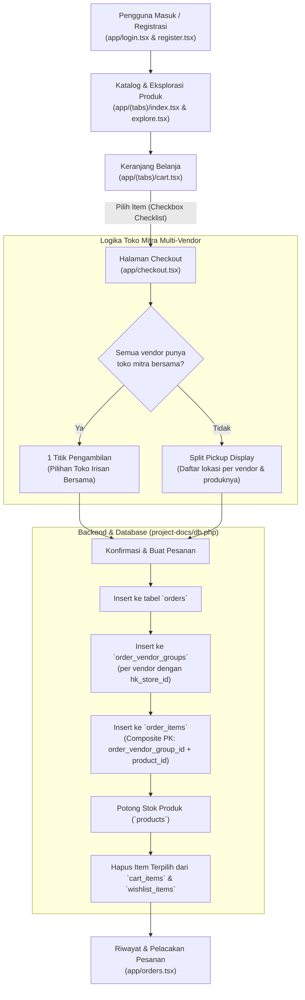

# Chandra Mall — Panduan & Dokumentasi Proyek

Selamat datang di repositori proyek **Chandra Mall**. Dokumen ini dirancang sebagai panduan komprehensif bagi pengembang yang baru melakukan *clone* proyek dari GitHub, mencakup latar belakang proyek, cara setup *frontend* dan *backend*, arsitektur dan alur data, rincian setiap halaman dan berkas, serta daftar fitur yang sudah maupun yang belum diimplementasikan.

---

## 1. Tentang Proyek (Project Overview)

**Chandra Mall** adalah platform *e-commerce cross-border* (lintas negara) yang dirancang untuk menghubungkan produk-produk **UMKM (Usaha Mikro, Kecil, dan Menengah) Indonesia** dengan konsumen di **Hong Kong**, khususnya diaspora Indonesia dan Pekerja Migran Indonesia (PMI).

### Karakteristik & Nilai Unik:
- **Model Logistik Konsolidasi & Toko Fisik (Offline Pickup Stores):** Berbeda dengan e-commerce konvensional yang mengirim barang satu per satu dengan ongkos kirim internasional yang mahal, barang dari berbagai vendor UMKM di Indonesia dikonsolidasikan dan dikirim ke titik-titik toko fisik mitra Chandra Mall di Hong Kong (misal: *Causeway Bay* dan *Mong Kok*). Pembeli kemudian mengambil pesanan mereka secara langsung di toko mitra pilihan.
- **Dukungan Multi-Vendor:** Pembeli dapat membeli barang dari beberapa vendor UMKM Indonesia dalam satu keranjang belanja.
- **Smart Store Allocation:** Sistem secara cerdas mendeteksi apakah vendor-vendor terpilih memiliki toko mitra bersama. Jika ya, pembeli cukup mengambil di 1 toko; jika tidak ada toko bersama, sistem secara otomatis membagi (*split pickup*) titik penjemputan per vendor dengan informasi produk yang transparan.

---

## 2. Arsitektur & Alur Kerja Sistem (System Flows)

### Diagram Alur Transaksi & Data:



---

## 3. Panduan Setup Setelah Clone dari GitHub

Ikuti langkah-langkah berikut untuk menjalankan proyek di komputer lokal:

### Prasyarat Sistem (Prerequisites):
1. **Node.js** (versi 18 LTS ke atas) dan **npm** / **bun**.
2. **Web Server Lokal & MySQL Database**: Disarankan menggunakan **XAMPP** (Apache + MySQL/MariaDB) atau Laragon.
3. **Expo Go** pada smartphone fisik (opsional, jika ingin menguji di perangkat *mobile*).

---

### Langkah 1: Setup Database MySQL
1. Pastikan modul **MySQL** pada XAMPP sudah berjalan (*running*).
2. Buka **phpMyAdmin** (`http://localhost/phpmyadmin`) atau klien MySQL favorit Anda.
3. Buat database baru bernama:
   ```sql
   CREATE DATABASE chandra_mall CHARACTER SET utf8mb4 COLLATE utf8mb4_unicode_ci;
   ```
4. Impor skema dan data awal dari berkas SQL yang sudah disediakan di repositori:
   - Lokasi berkas: `project-docs/databsae chandra mall.sql`
   - Berkas ini mencakup seluruh 19 tabel relasional (kategori, pengguna, vendor, produk, toko HK, keranjang, pesanan, dan ulasan) beserta data awal yang siap digunakan.

---

### Langkah 2: Setup Backend API (PHP)
1. Salin berkas backend API dari repositori ke direktori *web server* XAMPP:
   - Berkas sumber di repositori: `project-docs/db.php`
   - Salin ke: `C:\xampp\htdocs\chandra\db.php` (buat folder `chandra` jika belum ada).
2. Pastikan modul **Apache** pada XAMPP aktif (*running*).
3. Uji koneksi backend di peramban web (*browser*):
   - Kunjungi: `http://localhost/chandra/db.php?action=products`
   - Jika berhasil, Anda akan melihat data JSON berisi daftar produk.

---

### Langkah 3: Konfigurasi Endpoint Frontend (`constants/Api.ts`)
Buka berkas `constants/Api.ts` di proyek:
```typescript
export const BASE = "http://localhost/chandra/db.php";
```
- **Jika menjalankan di Browser (Web):** Gunakan `http://localhost/chandra/db.php`.
- **Jika menjalankan di Android Emulator:** Ubah menjadi `http://10.0.2.2/chandra/db.php`.
- **Jika menjalankan di Perangkat Fisik (Expo Go):** Ubah `localhost` menjadi alamat IP LAN komputer Anda pada jaringan Wi-Fi yang sama, contoh: `http://192.168.1.15/chandra/db.php`.

---

### Langkah 4: Instalasi Dependencies & Menjalankan Frontend
Jalankan perintah berikut di terminal root proyek:

```bash
# 1. Install seluruh paket dependensi
npm install

# 2. Jalankan server pengembangan Expo
npx expo start
```

- **Membuka di Web Browser:** Tekan tombol `w` di terminal.
- **Membuka di Android Emulator:** Tekan tombol `a` di terminal.
- **Membuka di HP (Expo Go):** Pindai kode QR yang muncul menggunakan aplikasi Expo Go di Android atau Kamera di iOS.

---

### Langkah 5: Pengecekan Kualitas Kode
Sebelum melakukan *commit* atau menyelesaikan pekerjaan, selalu verifikasi integritas kode:
```bash
npx tsc --noEmit    # Memastikan tidak ada kesalahan tipe TypeScript
npx expo lint       # Memastikan aturan linter ESLint terpenuhi
```

---

## 4. Struktur Direktori & Rincian Halaman / Berkas

```text
ChandraMall_Projek_KerjaPraktek/
├── app/                        # Halaman aplikasi berbasis Expo Router
│   ├── (tabs)/                 # Navigasi tab utama
│   │   ├── _layout.tsx         # Bottom navigation bar layout
│   │   ├── index.tsx           # Beranda (Home)
│   │   ├── explore.tsx         # Katalog & Pencarian (Explore)
│   │   ├── wishlist.tsx        # Daftar Favorit (Wishlist)
│   │   ├── cart.tsx            # Keranjang Belanja (Cart)
│   │   └── profile.tsx         # Akun Pengguna (Profile)
│   ├── category/
│   │   └── [slug].tsx          # Katalog produk berdasarkan kategori
│   ├── product/
│   │   └── [id].tsx            # Detail produk & ulasan
│   ├── vendor/
│   │   └── [slug].tsx          # Etalase profil toko vendor UMKM
│   ├── _layout.tsx             # Root layout aplikasi (Navbar, Stack, Auth session)
│   ├── checkout.tsx            # Alur checkout pintar multi-vendor
│   ├── login.tsx               # Halaman login pembeli
│   ├── orders.tsx              # Riwayat pesanan & pelacakan status
│   ├── register.tsx            # Pendaftaran akun pembeli baru
│   └── vendors.tsx             # Direktori daftar seluruh vendor UMKM
├── components/                 # Komponen antarmuka yang dapat digunakan kembali
│   ├── Footer.tsx              # Footer aplikasi (tautan navigasi & informasi)
│   ├── TopNavbar.tsx           # Navbar header atas (pencarian, keranjang, profil)
│   └── marketplace-product-card.tsx # Kartu produk katalog dengan aksi wishlist
├── constants/                  # Konfigurasi, tema, dan utilitas
│   ├── Api.ts                  # Alamat URL dasar backend API
│   ├── Colors.ts               # Palet warna resmi Chandra Mall
│   ├── format.ts               # Pemformatan mata uang HKD dan tanggal
│   └── session.ts              # Pengelolaan sesi autentikasi pengguna
└── project-docs/               # Dokumentasi proyek & artefak database
    ├── databsae chandra mall.sql # Skema database MySQL lengkap 19 tabel
    ├── db.php                  # Skrip backend REST API
    ├── BAB5_IMPLEMENTASI.md    # Laporan implementasi kerja praktek
    └── README.md               # Panduan utama proyek (berkas ini)
```

### Rincian Setiap Halaman & Perannya:

| Halaman / Berkas | Rute | Deskripsi & Fungsionalitas |
| :--- | :--- | :--- |
| **`app/login.tsx`** | `/login` | Otentikasi pembeli menggunakan alamat email dan kata sandi, dilengkapi validasi input dan penanganan pesan kesalahan. |
| **`app/register.tsx`** | `/register` | Registrasi pembeli baru dengan validasi nama lengkap, format email, nomor telepon, dan kata sandi. |
| **`app/(tabs)/index.tsx`** | `/` | Beranda utama menampilkan hero banner, baris kategori cepat, produk unggulan, dan kartu produk UMKM Indonesia. |
| **`app/(tabs)/explore.tsx`** | `/explore` | Pencarian langsung (*real-time search*), penyaringan berdasarkan kategori dan urutan harga/rating, serta navigasi produk. |
| **`app/(tabs)/wishlist.tsx`** | `/wishlist` | Menampilkan produk yang disukai pengguna, dengan aksi langsung memasukkan ke keranjang belanja atau menghapus dari daftar. |
| **`app/(tabs)/cart.tsx`** | `/cart` | Keranjang belanja dengan **fitur seleksi checklist**: hanya item yang dicentang yang akan diproses ke *checkout*. Mendukung ubah jumlah (+/-) dan catatan khusus. |
| **`app/(tabs)/profile.tsx`** | `/profile` | Tampilan profil pengguna yang sedang masuk, informasi kontak, akses cepat ke riwayat pesanan, dan tombol keluar (*logout*). |
| **`app/checkout.tsx`** | `/checkout` | **Checkout Cerdas Multi-Vendor**: Mengelompokkan produk terpilih berdasarkan vendor, mendeteksi ketersediaan toko mitra penjemputan bersama (*common store*) atau membagi titik penjemputan (*split pickup*), menampilkan ringkasan biaya, dan membuat pesanan. |
| **`app/orders.tsx`** | `/orders` | Riwayat pesanan pengguna dengan tab status (*Semua, Menunggu Pembayaran, Diproses, Siap Diambil, Selesai*), rincian sub-pesanan vendor, lokasi toko penjemputan, dan modal *timeline* pelacakan pesanan. |
| **`app/product/[id].tsx`** | `/product/[id]` | Detail spesifikasi produk, galeri gambar, status kelayakan ekspor (*is_exportable*), informasi vendor asal, tombol tambah ke keranjang, dan beli sekarang. |
| **`app/vendor/[slug].tsx`** | `/vendor/[slug]` | Profil lengkap vendor UMKM asal Indonesia (kota asal, deskripsi toko, rating rata-rata) beserta seluruh etalase produk yang mereka jual. |
| **`app/vendors.tsx`** | `/vendors` | Direktori penjelajahan seluruh vendor UMKM yang bekerja sama dengan Chandra Mall. |
| **`app/category/[slug].tsx`** | `/category/[slug]` | Menampilkan seluruh produk yang tergolong dalam kategori yang dipilih pengguna. |

---

## 5. Fitur yang Sudah Diimplementasikan (Implemented)

1. **Otentikasi & Manajemen Pengguna:**
   - Halaman Login & Registrasi dengan validasi format email dan kata sandi.
   - Sesi pengguna tersimpan di `constants/session.ts` untuk melayani transaksi dinamis.
2. **Katalog & Eksplorasi Produk:**
   - Penjelajahan produk berdasarkan kategori (*Makanan Khas, Bumbu Dapur, Busana, Kerajinan, Kesehatan*).
   - Pencarian kata kunci (*search*) dan pengurutan (*sorting*).
   - Profil toko vendor UMKM Indonesia beserta produknya.
3. **Wishlist & Keranjang Belanja Selektif (Partial Cart):**
   - Tambah/hapus produk ke/dari wishlist.
   - Checklist produk pada keranjang belanja: pengguna bebas memilih item mana saja yang ingin di-checkout, sementara item lain tetap tersimpan di keranjang.
4. **Logika Checkout Multi-Vendor & Toko Penjemputan Pintar:**
   - **Intersection Store Matching:** Jika semua vendor dari produk yang dipilih bermitra dengan setidaknya satu toko yang sama di Hong Kong, pembeli memilih 1 toko penjemputan bersama.
   - **Split Pickup Allocation:** Jika tidak ada toko bersama, checkout otomatis membagi daftar menjadi beberapa titik pengambilan sesuai mitra masing-masing vendor lengkap dengan rincian barangnya.
5. **Manajemen Database Relasional Kuat:**
   - Pemisahan entitas pesanan induk (`orders`) dan sub-pesanan vendor (`order_vendor_groups`).
   - Tabel `order_items` menggunakan **Composite Primary Key** `(order_vendor_group_id, product_id)` bertipe `NOT NULL` dengan *Foreign Key CASCADE & RESTRICT*.
   - Otomatisasi pemotongan stok barang (`products.stock`) dan pembersihan produk yang dibeli dari keranjang & wishlist.
6. **Pelacakan & Riwayat Pesanan:**
   - Antarmuka riwayat pesanan dengan penanda toko penjemputan.
   - Modal pelacakan status logistik (*order tracking timeline*) dari status menunggu konfirmasi hingga siap diambil di toko Hong Kong.

---

## 6. Rencana Pengembangan Selanjutnya (Yet to be Implemented / Roadmap)

Fitur-fitur berikut direncanakan untuk tahap pengembangan berikutnya:

1. **Integrasi Gerbang Pembayaran Riil (Payment Gateway Integration):**
   - Menggantikan placeholder otomatis lunas saat ini dengan integrasi gerbang pembayaran populer di Hong Kong (misal: *AlipayHK, WeChat Pay HK, Octopus Card, FPS / Faster Payment System*) atau *Stripe / Midtrans*.
2. **Portal Khusus Vendor UMKM (Vendor Dashboard):**
   - Halaman khusus bagi vendor di Indonesia untuk mengelola inventaris, menerima notifikasi pesanan masuk, mencetak label paket ekspor, dan menginput nomor resi pengiriman kargo.
3. **Portal Kasir Toko Mitra Hong Kong (HK Store Pickup Scanner):**
   - Antarmuka pemindaian kode QR bagi staf toko fisik di Hong Kong untuk memvalidasi kedatangan kiriman kargo dari Indonesia dan memvalidasi kode penjemputan saat pembeli datang mengambil barang.
4. **Notifikasi Otomatis (Push Notifications):**
   - Mengintegrasikan Expo Push Notifications untuk memberitahu pembeli saat status pesanan berubah (misal: pesanan telah tiba di toko fisik dan siap diambil).
5. **Pelacakan Logistik & Bea Cukai (Customs Integration):**
   - Integrasi webhook status kurir kargo internasional dan proses *customs clearance* secara langsung.
